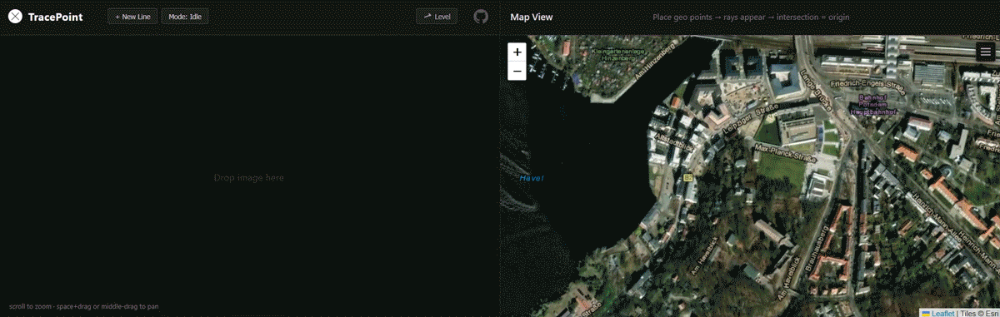
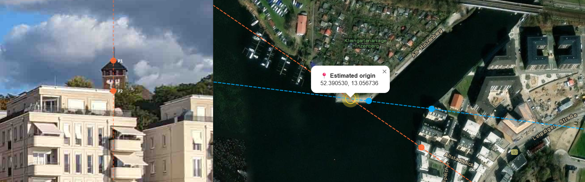
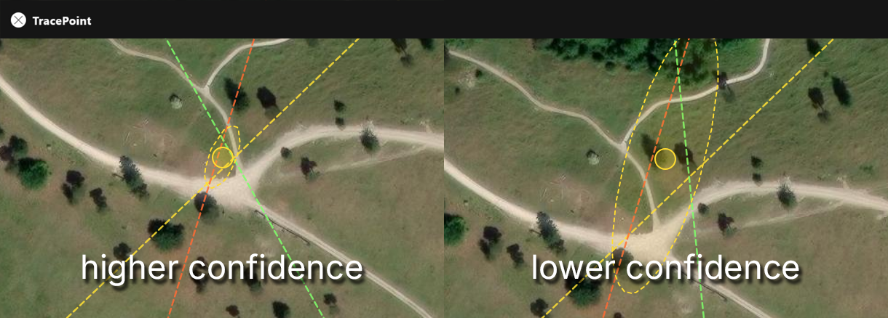

<h1> TracePoint</h1>

**Locate the origin point of a photograph using geometric ray intersection.**

`TracePoint` is a browser-based geolocation tool built for OSINT investigators, journalists, and researchers who already know how to geolocate images, and want a dedicated instrument to do it faster and more precisely. No uploads. No server. Everything runs locally in your browser.

**[Try it live → kluter.github.io/TracePoint](https://kluter.github.io/TracePoint/)**



---

## The Method

Draw a vertical line across a photograph and it passes through objects at different depths: foreground, midground, horizon. Each of those objects can be found on a map, and together they define a geographic bearing: a **ray**.

Repeat for a second line and you get a second ray. **Where the rays cross is where the photographer was standing.**

The more lines you add, the more rays are generated and the more robustly the intersection is averaged. This is a photographic application of the surveying technique known as **[Resection by Intersection](https://en.wikipedia.org/wiki/Position_resection_and_intersection)**, the same principle used to triangulate a position from known landmarks. `TracePoint` turns that manual, tab-switching workflow into a single focused tool.

---

## Features

- **Fully client-side:** no server, no uploads, no tracking
- **Images as tabs:** each image is a tab in the photo header; all sessions visible on the map simultaneously, each with its own intersection result
- **Bearing display:** each line shows its outward bearing once an intersection is found
- **Confidence ellipse:** with 3 or more lines (up to 5 per image), a dashed ellipse around the intersection shows the spread of ray crossings. A tighter ellipse means higher confidence
- **Session export and import:** save and restore lines, geo points, bearings, and map view as JSON, with the photos inside the file if you switch that on
- **Street-level imagery:** a panel above the map shows the nearest Panoramax or Mapillary photo, 360° ones to look around in, with a marker for position and view direction
- **Resizable layout:** drag the divider between photo and map, double-click it for 50/50, or fold the photo side away with the chevron on it
- **Autosave:** work and images are kept in this browser, so a refresh does not lose them. Switch it off or clear it in the ☰ menu of the photo side
- **EXIF metadata viewer:** camera, lens, capture settings, GPS, altitude, and camera direction read from the image. GPS can be placed on the map as a reference marker
- **Basemap dropdown:** the map header shows the active basemap; click it to switch or to add a custom layer
- **Map panel:** terrain, 3D buildings and camera settings in one place; match the field of view to a photo's lens and compare skylines on the tilted map
- **Map layers:** Esri Satellite, Sentinel-2 2024, OpenStreetMap, Esri Dark Gray, Esri Topo, Esri Streets, optional 3D terrain with adjustable height and hillshade, plus [custom XYZ layers](#custom-map-layers) by URL
- **[Coordinate search](#coordinate-search):** paste coordinates (decimal, degrees-minutes-seconds or a Google Maps link) to drop numbered pins on the map
- Horizon correction for tilted images
- Built-in Potsdam demo with step-by-step guide

---

## How to Use

> Start with the **☰** menu on the photo side and select **Potsdam, Germany** in its Demo section for a guided walkthrough. If the photo is tilted, use the level button (left of that menu) first to compensate before adding lines.

1. **Load a photo:** Drop an image onto the left panel, paste one with `Ctrl+V`, or click **Browse**. A pasted photo opens as `pasted_image_01`, `pasted_image_02`, … and has no EXIF data, because the clipboard hands over pixels only; drop the file if you need its GPS or camera data. To work on multiple images at once, open the **☰** image menu and click **+ Add image**.
2. **Add a line:** Click the **+** button at the left of the line bar (or press `E`) and drag it over a recognisable object you can also find on the map: a building corner, tower, road junction.
3. **Mark points:** Click the active line twice to place exactly two reference points. A drag still moves the line; a click on another line only selects it.
4. **Place points on the map:** After the second point the map waits for the first one: click its real-world location, then the second. A tag next to the mouse says which point comes next. To place a point again later, click its **🌐 P1** pill or press `F` for the next unmapped point.
5. **Read the result:** Once two lines each have two geo points, rays appear and the intersection is calculated. The pulsing yellow marker shows the estimated camera origin. With 3 or more lines, a confidence ellipse appears around the intersection: the tighter the ellipse, the more consistent your bearings.
6. **Add more images:** Click **+** after the image tabs in the photo header. Each session shows its own rays and intersection on the map simultaneously.
7. **Save your work:** Open the **☰** menu of the photo side: **↓ Export this image** saves the image on screen as JSON, **↓ Export all** saves everything at once. To restore, click **↑ Import…** and reload the image when prompted. With **Include photos** switched on in the same menu, the exported file carries the photos and the import needs no reloading; `Ctrl+S` exports everything with the current setting.

> **Tips:** Use objects spread across different depths for a more accurate bearing. Press `Esc` to deselect or cancel at any time. Press `X` to toggle the help card from anywhere on the page.



---

## Controls

### Mouse & UI

| Action | How |
|---|---|
| Pan image | Space + drag, or middle-click drag |
| Level image | Level button in the line bar, in the button group left of the ☰ menu, then click two points on a horizontal reference. Click it again to reset |
| Deselect / cancel | Click blank canvas, or `Esc` |
| Place point on map | Click the map pill, then click the map |
| Move a point | Drag its marker on the map, or slide it along its line on the image. `Esc` while dragging snaps it back |
| Adjust the photo on screen | ☀ button in the line bar: contrast and brightness 25–300%, saturation 0–300%, invert. Double-click a slider to reset it. The button next to ☀ switches between the original and the adjusted photo. Display only: the photo, lines and exports are untouched |
| Fit the photo | Corner-brackets button in the line bar: the whole photo, centred in the panel |
| Images | Tabs in the photo header: click to switch, double-click the name or `F2` to rename, × to remove, **+** to add |
| New line | **+** button at the left of the line bar, or `E` |
| Export, import, demo | ☰ button, right of the line bar |
| Export with photos | **Include photos** switch in the ☰ menu of the photo side, off by default. On: every export stores each photo inside the JSON, unchanged, with its GPS and camera data; the file gets about a third bigger than the photo. Import then restores the photo by itself |
| Autosave on / off, clear saved work | **This browser** section of the ☰ menu of the photo side. Off or **Clear** deletes the copy kept in the browser |
| Image metadata | `</>` button in the line bar. **Show on map** places the EXIF GPS position; the same button, now **Remove from map**, takes it away again |
| Rotate / tilt map | Ctrl + drag, or right-click drag, tilt up to 90°. Click the compass (bottom-left of the map) or press `N` to reset. The map bar shows bearing, tilt and zoom |
| Basemap | The name in the map header: click it for the list. The active one is highlighted. Custom layers: **+ Add custom layer…**, then ✎ / × to edit or remove |
| Terrain, buildings and camera | Sliders button, right of the map bar. One panel: **Terrain** (3D terrain, height 1–3×, hillshade), **Buildings** (OpenStreetMap buildings as 3D blocks from zoom 13, with opacity) and **Camera** (field of view with its full-frame focal length, max tilt, min and max zoom, **North up**, **Top down**). **Reset** puts all sliders back to their defaults; double-click a slider to reset just that one |
| Jump to coordinates | Paste into the search box in the map bar (or `Ctrl+V` anywhere) |
| Measure a distance | Ruler button next to the compass, `M`, or right-click → **Measure distance from here**. Click two points for the straight-line ground distance; a third click starts over, `Esc` clears. Not saved or exported |
| Street-level imagery | Panorama button in the map bar, or right-click → **Street-level imagery here**. A panel above the map shows the nearest photo; drag the divider under it to resize. Pick **Panoramax** (no key) or **Mapillary** (paste your own free client token). The map moves to where the photo was taken. Click in the photo to walk towards that side, or use the arrow keys (up and down walk along the view, left and right step sideways). 360° photos: drag to look around, wheel zooms. **Map centre** looks up the middle of the map, **HD** loads the full resolution. With Panoramax, **Coverage** draws on the map where photos exist: lines along the sequences (solid for 360°, dashed for ordinary photos) and, zoomed in close, a dot per photo; click a line or dot to load the photo there. The yellow marker on the map is the photo's position and view direction |
| Pins | Click a row in the pin list at the top-left of the map to go back to it; × or **Clear all** removes |
| Copy a spot / open it elsewhere | Right-click the map: copy coordinates, measure from there, or open the spot in Google Maps, Street View, Google Earth or OpenStreetMap. **Open in…** adds Apple Maps, Lookmap, Bing Maps, Mapillary, Yandex Maps and Baidu Maps. Nothing is requested from any of them until you click |
| Share or bookmark a view | Copy the URL: the map view is in the `#` part, nothing else |

### Keyboard shortcuts

| Key | Action |
|---|---|
| `W` | Toggle level tool / reset rotation |
| `E` | New line |
| `R` | Delete active line |
| `F` | Map next unmapped point of active line |
| `X` | Toggle help card |
| `Del` / `Backspace` | Delete the selected point, or the active line if no point is selected |
| `1` – `5` | Jump to line 1–5 |
| `Esc` | Cancel / deselect |
| `F2` | Rename the active image |
| `Ctrl+Z` | Undo a line or point edit; `Ctrl+Shift+Z` or `Ctrl+Y` redoes |
| `Ctrl+S` | Export all sessions (with photos if **Include photos** is on) |
| `Ctrl+V` | Paste a photo → new image; paste coordinates → pin on map |
| `N` | Reset map to north |
| `M` | Measure a distance on the map (again or `Esc` to clear) |

---

## Coordinate Search

Paste coordinates into the search box in the bar under the map header, or press `Ctrl+V` anywhere outside a text field. Each location gets a numbered pin and a row in the pin list at the top-left of the map, which brightens on hover. The map keeps your zoom if you are already at town level or closer, otherwise it flies to zoom 14.

### Accepted formats

| Format | Example |
|---|---|
| Decimal, comma | `52.401234, 13.064567` |
| Decimal, space | `52.401234 13.064567` |
| Negative values (S / W) | `-33.8568, 151.2153` |
| Decimal with hemisphere | `52.4012° N, 13.0645° E` |
| Hemisphere letter first | `N 52.4012 E 13.0645` |
| Degrees, minutes, seconds | `52°24'04.4"N 13°03'52.4"E` |
| Degrees, decimal minutes | `52°24.073'N 13°03.874'E` |
| Longitude first | `13.0645° E, 52.4012° N`, or `151.2153, -33.8568` |
| Labelled | `lat 52.4012 lon 13.0645` |
| Google Maps link (map view) | `https://www.google.com/maps/@52.4012,13.0645,15z` |
| Google Maps link (query) | `https://maps.google.com/?q=52.4012,13.0645` |
| Google Earth link | `https://earth.google.com/web/@52.4012,13.0645,35a,1000d,35y,0h,0t,0r` |
| Apple Maps link | `https://maps.apple.com/?ll=52.4012,13.0645` |
| Bing Maps link | `https://www.bing.com/maps?cp=52.4012~13.0645&lvl=15` |
| Yandex Maps link (longitude first) | `https://yandex.com/maps/?ll=13.0645,52.4012&z=15` |
| OpenStreetMap link | `https://www.openstreetmap.org/#map=15/52.4012/13.0645` |
| Lookmap link | `https://lookmap.skzk.dev/#c=15/52.4012/13.0645` |
| Baidu Maps link (approximate) | `https://map.baidu.com/@12959219,4825334,15z` |
| Any link with `lat=` and `lon=` or `lng=` | `https://example.com/?lat=52.4012&lon=13.0645` |
| Web Mercator metres (x, y) | `1454336, 6872995` |

The first number is read as latitude, unless N/S/E/W letters or a value above 90 say otherwise.

A link's zoom level is ignored: a pasted link drops a pin like any other paste. Short links such as `maps.app.goo.gl/…` contain no coordinates and cannot be read without asking their server, so TracePoint asks you to open them and copy the full address. Baidu uses its own shifted coordinate system; its links are converted in the browser and land within some metres.

---

## Map View in the URL

The address bar follows the map: `#lat,lon,zoom`, plus `,bearing,pitch` when the map is rotated or tilted, e.g. `#45.94060,7.71737,15.00`. Copy the URL to come back to the same view or to send it to someone; it holds the view only, never your lines, points or image.

---

## Custom Map Layers

Besides the built-in layers you can add any tile server that uses the standard XYZ URL format, the same format QGIS uses for its "XYZ Tiles" connections. Click the basemap name in the map header, then **+ Add custom layer…**, give it a name and paste the URL template. The template must start with `https://` and contain `{x}`, `{y}` and `{z}`:

```
https://example.com/tiles/{z}/{x}/{y}.png
```

You can add as many layers as you like and switch between them like the built-in ones. They are saved in your browser's `localStorage` only. They are not shared between browsers or devices, and they are not included in exported session files.

### Useful tile URLs

Copy a URL into the **Tile URL** field as-is. Every server has its own terms of use. Which servers you add, and whether you are allowed to use them, is up to you.

**Google (at your own risk)**

Google does not permit direct tile access outside its official APIs. These URLs are widely used in [QGIS tutorials](https://mapscaping.com/google-satellite-imagery-and-google-maps-in-qgis/), but using them may break Google's terms and can stop working at any time:

| Layer | URL |
|---|---|
| Google Satellite | `https://mt1.google.com/vt/lyrs=s&x={x}&y={y}&z={z}` |
| Google Hybrid | `https://mt1.google.com/vt/lyrs=y&x={x}&y={y}&z={z}` |
| Google Roadmap | `https://mt1.google.com/vt/lyrs=m&x={x}&y={y}&z={z}` |
| Google Terrain | `https://mt1.google.com/vt/lyrs=p&x={x}&y={y}&z={z}` |

**Imagery**

| Layer | URL | Notes |
|---|---|---|
| Esri Clarity | `https://clarity.maptiles.arcgis.com/arcgis/rest/services/World_Imagery/MapServer/tile/{z}/{y}/{x}` | Esri's sharper imagery set. Sometimes shows a different capture than the built-in Esri Satellite |
| Esri Wayback | `https://wayback.maptiles.arcgis.com/arcgis/rest/services/World_Imagery/WMTS/1.0.0/default028mm/MapServer/tile/RELEASE/{z}/{y}/{x}` | Historical Esri imagery. Replace `RELEASE` with a release number from the table below |

**Esri Wayback releases**

Esri has published the World Imagery basemap as a dated snapshot roughly every few weeks since 2014. Each snapshot has a release number, and that number goes into the URL in place of `RELEASE`. The numbers are IDs, not dates, so they do not run in order. Add several releases as separate layers to flip between dates and see when a building appeared or a road changed.

| Snapshot | Release | Snapshot | Release |
|---|---|---|---|
| 2014-02-20 | `10` | 2021-01-13 | `1049` |
| 2015-01-21 | `20222` | 2022-01-12 | `42663` |
| 2016-01-13 | `3515` | 2023-01-11 | `11475` |
| 2017-01-11 | `577` | 2024-01-18 | `41468` |
| 2018-01-08 | `13161` | 2025-01-30 | `36557` |
| 2019-01-09 | `6036` | 2026-01-29 | `22252` |
| 2020-01-08 | `23001` | 2026-10-29 | `43291` |

All ~200 releases are listed in Esri's [Wayback config](https://s3-us-west-2.amazonaws.com/config.maptiles.arcgis.com/waybackconfig.json): search for a date, and the number after `tile/` in that entry's `itemURL` is the release. To find which releases actually changed the imagery at a given place, use Esri's [Wayback app](https://livingatlas.arcgis.com/wayback/). A snapshot date is when Esri published the release, not when the imagery was captured. Where nothing changed between releases, they show the same imagery.

Providers whose tiles use a different numbering scheme, such as Bing (quadkeys), cannot be added this way.

A custom layer's tiles are requested from the server in its URL. See [Security & Privacy](#security--privacy) for what that means.

---

## Reading the Confidence Ellipse

When three or more lines are used, a dashed ellipse appears around the estimated camera position. Its size and shape tell you how much to trust the result.

| Ellipse shape | Meaning | Confidence |
|-------|---------|------------|
| Small and round | Rays converge tightly from all directions | High |
| Small and elongated | Good estimate, but uncertain along one axis. Two lines may be nearly parallel | Moderate |
| Large and round | General spread in all directions, recheck geo points or add more lines | Low |
| Large and elongated | One bearing is likely off, or two lines run too close to parallel | Low |


The ideal result is a small, round ellipse. If you see a large or elongated one, adding a line at a different angle usually improves it significantly.

How it is computed: every pair of rays produces a crossing point, and those crossings form a small cloud around the estimated origin. The ellipse is fitted to that cloud using [Eigendecomposition](https://en.wikipedia.org/wiki/Eigendecomposition_of_a_matrix). It stretches in the direction the crossings are most scattered and stays narrow where they agree.

---

## Technical Notes

Rays are computed from the bearing between two geo-referenced points. Each ray extends 50 km in both directions, long enough to contain any realistic intersection while keeping the map readable.

Intersection uses flat-plane geometry on lat/lon coordinates. For most photography this is accurate to within a few metres. The assumption holds well as long as the distance between the camera and the furthest reference landmark stays under roughly 10 km, which covers virtually all real-world OSINT photography. Accuracy degrades in the following cases:

- **Very steep mountainous terrain.** When reference landmarks sit at dramatically different elevations than the camera, the apparent bearing in the image no longer matches the flat map bearing.
- **Aerial photography.** Shooting downward at an angle from a plane or drone introduces the same kind of vertical distortion as steep terrain.
- **Very long rays.** Reference points placed more than 20 to 30 km apart on the map, where the curvature of the Earth starts to affect flat-plane calculations.
- **Heavily distorted lenses.** Fisheye or extreme wide-angle lenses warp straight lines, so bearing lines drawn on the image no longer correspond accurately to real-world directions.

TracePoint has no server. Nothing you load or draw leaves your machine; the only requests are for map tiles (see [Security & Privacy](#security--privacy)). It is vanilla HTML, CSS and JavaScript plus two bundled libraries: [MapLibre GL JS](https://maplibre.org/) for the map and [exifr](https://github.com/MikeKovarik/exifr) by MikeKovarik for metadata.

---

## Running Locally

```bash
npx serve .
# or
python3 -m http.server
```

---

## Changelog

Current version: **v2.8.0**. All releases are listed in [CHANGELOG.md](CHANGELOG.md).

---

## Recognition

### Curated Lists

| List | Section |
|---|---|
| [jivoi/awesome-osint](https://github.com/jivoi/awesome-osint) | Image Analysis |
| [Astrosp/Awesome-OSINT-List](https://github.com/Astrosp/Awesome-OSINT-List) | GEO |
| [The-Osint-Toolbox/Geolocation-OSINT](https://github.com/The-Osint-Toolbox/Geolocation-OSINT) | Geolocation |

### Press

| Publication | Publisher |
|---|---|
| [TracePoint: A Browser-Based Tool for Image Geolocation by Ray Intersection](https://remote-sensing.org/tracepoint-a-browser-based-tool-for-image-geolocation-by-ray-intersection/) | Earth Observation Research Cluster, University of Würzburg |

---

## Security & Privacy

A polished interface is not the same as a safe one. This section explains exactly what TracePoint does and does not do with your data, so investigators can make an informed decision before using it on sensitive material.

### Images never leave your machine

Photos are loaded directly into an HTML5 `<canvas>` element and processed in the browser. No upload, no base64 POST, no fetch call carries image data anywhere. To verify, open **DevTools → Network** (`F12`) and load an image: no request involving it appears.

The only outbound requests are map tile fetches from public servers (Esri, OpenStreetMap, EOX), elevation tiles from AWS while 3D terrain or hillshade is switched on, building shapes from OpenFreeMap while 3D buildings is switched on, plus the servers of any [custom map layer](#custom-map-layers) you add yourself. They contain no session data, no coordinates from your work, and no image content.

Street-level imagery is the one feature that sends a position on purpose: while its panel is open, Panoramax or Mapillary (whichever you picked) receives a small box around the spot you look up, and serves the photo. The panel is closed on every start, and nothing is sent until you open it. Your own photo is never part of it.

```javascript
// The full extent of network activity in TracePoint:
// GET https://server.arcgisonline.com/ArcGIS/rest/services/.../tile/z/y/x
// GET https://tile.openstreetmap.org/z/x/y.png
// GET https://tiles.maps.eox.at/wmts/1.0.0/s2cloudless-2024_3857/default/g/z/y/x.jpg
// GET <your custom layer URL>   ← only if you add one and select it
// GET https://s3.amazonaws.com/elevation-tiles-prod/terrarium/z/x/y.png   ← only while 3D terrain or hillshade is on
// GET https://tiles.openfreemap.org/planet/...                          ← only while 3D buildings is on
// GET https://api.panoramax.xyz/api/search?bbox=... + the photo it names ← only while the street-level panel is open (Panoramax)
// GET https://api.panoramax.xyz/api/map/z/x/y.mvt                         ← coverage overlay, only while the panel is open with Coverage on
// GET https://graph.mapillary.com/images?bbox=... + the photo it names   ← only while the street-level panel is open (Mapillary, your token)
// No other requests.
```

### What stays in the browser

- **Pasted coordinates and photos.** TracePoint never reads your clipboard on its own. Text or an image arrives only when you paste. Text is parsed in the browser, and no geocoder or lookup service is contacted. Pins live in memory and disappear with the tab. A pasted photo is handled like a dropped one: it stays in the browser and is covered by autosave.
- **The URL hash.** Browsers never send the part after `#` to the server, so whoever hosts your copy does not see which places you look at. It holds the map view only.
- **The right-click menu.** It only builds ordinary links. Nothing is contacted until you click one, and a link carries the clicked coordinate and zoom, never your image or session.

### Autosave keeps your work in this browser

So that a refresh does not lose work, TracePoint saves the open sessions and their images in this browser's `IndexedDB`. Nothing is uploaded and nothing is synced: the saved copy exists only in this browser profile on this machine. Anyone who can use that profile can open TracePoint and see it.

- **It survives** closing the tab, restarting the browser and a hard reload (`Ctrl+F5`, `Ctrl+Shift+R`). A hard reload only skips the cache.
- **Clear** in the ☰ menu of the photo side deletes the saved copy and empties the workspace.
- **Autosave off** in the same menu deletes the saved copy at once and stores nothing from then on. Use this for sensitive material; closing the tab then leaves no trace of the investigation.
- A private window works as usual; the browser deletes the saved copy when that window closes.
- Two tabs share one saved copy; the last change wins.

Photo adjustments and coordinate pins are not saved. Besides that, `localStorage` holds a few settings. `sessionStorage` and cookies are unused.

```javascript
// Verify in DevTools → Application → Storage
// localStorage:   { "tp-tileset": "esri-sat" }  ← your map layer choice
//                 { "tp-terrain": "0" }         ← 3D terrain on/off
//                 { "tp-map-settings": {...} }  ← terrain height, hillshade, 3D buildings, field of view, camera limits
//                 { "tp-custom-layers": [...] } ← name + URL of custom layers, if you added any
//                 { "tp-autosave": "1" }        ← autosave on/off
//                 { "tp-split": "50.00" }       ← width of the photo side in percent
//                 { "tp-export-photos": "1" }   ← "Include photos" on/off
//                 { "tp-street-source": "…" }   ← Panoramax or Mapillary
//                 { "tp-street-token": "…" }    ← your Mapillary token, if you entered one (never exported)
//                 { "tp-street-cover": "1" }    ← coverage overlay on/off
//                 { "tp-street-split": "45.00" } ← height of the street-level panel in percent
// IndexedDB:      tracepoint → autosave         ← "session" (same JSON as the export) + one "img:…" per image
//                                                 empty while autosave is off
// sessionStorage: empty
// Cookies:        none set by TracePoint
```

### Session import cannot run code

Importing a session file does not execute anything. Every field is type-checked on the way in, unknown keys are discarded, and strings are escaped before display. There is no `eval()` and no raw HTML injection. The worst a manipulated file can do is fail to import.

### The code is fully auditable

TracePoint is vanilla HTML, CSS, and JavaScript with no build step and no obfuscation. Its own logic lives in `js/script.js`, unminified. What you read in the repo is what runs in your browser.

The two libraries, [MapLibre GL JS](https://maplibre.org/) (map rendering) and [exifr](https://github.com/MikeKovarik/exifr) (EXIF parsing, local only), are their standard minified builds, bundled in `js/` and `css/` and pinned to a known version. Nothing is loaded from a CDN, so no third-party host can swap the code that runs in your browser. To verify a bundled copy, compare it with the official release of the same version.

This tool was developed with AI assistance. That is disclosed here precisely because the [risks of opaque, AI-generated OSINT tools](https://www.dutchosintguy.com/post/vibe-coding-is-becoming-an-osint-risk) are real. The answer is not to hide the involvement. It is to make the code readable so anyone can verify what it does.

### Security caveats

- **Map tiles reveal your target location.** Tile requests follow the format `tile/z/x/y`. The coordinates directly encode the area of the map you are viewing. A tile server operator can infer what location you are investigating. Use a VPN or TOR if that is a concern.
- **Custom layers add another party.** A custom layer's server sees the same tile coordinates. If its URL carries an API key or token, that key is also tied to every request, and it is stored in plain text in your browser.
- **Browser and OS trust.** If your browser or operating system is compromised, no web application can protect you. TracePoint is only as secure as the environment it runs in.
- **Files and saved work are unencrypted.** Exported JSON files and the autosaved copy in the browser are plaintext. Treat them with the same care as any other sensitive investigation material.

---

## Related

 **[ShadowFinder Web](https://github.com/kluter/ShadowFinder-Web)** - Geolocate a photo by the length of a shadow.

 **[SiliconAperture](https://github.com/kluter/SiliconAperture)** - Measure the real-world size of an object from a single photograph.
