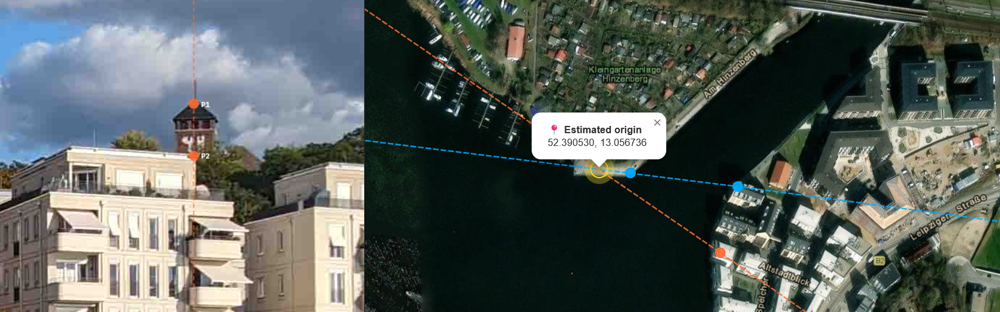
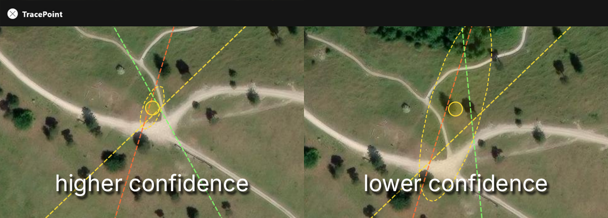

<h1> TracePoint</h1>

**Locate the origin point of a photograph using geometric ray intersection.**

`TracePoint` is a browser-based geolocation tool built for OSINT investigators, journalists, and researchers who already know how to geolocate images, and want a dedicated instrument to do it faster and more precisely. No uploads. No server. Everything runs locally in your browser.

**[Try it live → kluter.github.io/TracePoint](https://kluter.github.io/TracePoint/)**


---

## The Method

Draw a vertical line across a photograph and it passes through objects at different depths: foreground, midground, horizon. Each of those objects can be found on a map, and together they define a geographic bearing: a **ray**.

Repeat for a second line and you get a second ray. **Where the rays cross is where the photographer was standing.**

The more lines you add, the more rays are generated and the more robustly the intersection is averaged. This is a photographic application of the surveying technique known as **[Resection by Intersection](https://en.wikipedia.org/wiki/Position_resection_and_intersection)**, the same principle used to triangulate a position from known landmarks. `TracePoint` turns that manual, tab-switching workflow into a single focused tool.

---

## Features

- Split-panel interface: photo left, satellite map right
- Drop any image to load it, or click **Browse**
- **Multi-image session manager:** all sessions visible on the map simultaneously, each with its own intersection result
- **Bearing display:** each line shows its outward bearing once an intersection is found
- **Confidence ellipse:** with 3 or more lines (up to 5 per image), a dashed ellipse around the intersection visualises the spread of ray crossings. A tighter ellipse means higher confidence. Computed via [Eigendecomposition](https://en.wikipedia.org/wiki/Eigendecomposition_of_a_matrix)
- **Session export and import:** save and restore lines, geo points, bearings, and map view as JSON
- **EXIF metadata viewer:** camera, lens, capture settings, GPS, altitude, and camera direction read from the image. GPS can be placed on the map as a reference marker
- Built-in Potsdam demo with step-by-step guide
- Horizon correction for tilted images
- Map layer switcher: Esri Satellite, Sentinel-2 2024, OpenStreetMap, Esri Dark Gray, Esri Topo, Esri Streets
- 3D terrain (off by default): tilt the map to see the relief, clicks land on the slope
- **Custom map layers:** add any XYZ tile source by URL (same format as QGIS), saved in your browser
- **[Coordinate search](#coordinate-search):** paste coordinates (decimal, degrees-minutes-seconds or a Google Maps link) to drop numbered pins on the map
- Full keyboard shortcut support
- Fully client-side: no server, no uploads, no tracking

---

## How to Use

> Start with the **☰** menu on the image panel and select **Demo — Potsdam** for a guided walkthrough. If the photo is tilted, use the **Level** button first to compensate before adding lines.

1. **Load a photo:** Drop an image onto the left panel, or click **Browse**. To work on multiple images at once, open the **☰** image menu and click **+ Add image**.
2. **Add a line:** Click **+ New Line** (or press `E`) and drag it over a recognisable object you can also find on the map: a building corner, tower, road junction.
3. **Mark points:** Switch to **Add Point** mode (or press `Tab`) and click on the line twice to place exactly two reference points.
4. **Place points on the map:** Click the **🌐 P1** pill next to each point (or press `F` to jump straight to the next unmapped point), then click its real-world location on the map.
5. **Read the result:** Once two lines each have two geo points, rays appear and the intersection is calculated. The pulsing yellow marker shows the estimated camera origin. With 3 or more lines, a confidence ellipse appears around the intersection: the tighter the ellipse, the more consistent your bearings.
6. **Add more images:** Use the **☰** image menu to add further sessions. Each session shows its own rays and intersection on the map simultaneously.
7. **Save your work:** Click the **↓** button on any session row to export it as JSON, or use **↓ Export all sessions** to save everything at once. To restore, click **↑ Import session** and reload the image when prompted.

> **Tips:** Use objects spread across different depths for a more accurate bearing. Press `Esc` to deselect or cancel at any time. Press `X` to toggle the help card from anywhere on the page.



---

## Controls

### Mouse & UI

| Action | How |
|---|---|
| Zoom image | Scroll wheel |
| Pan image | Space + drag, or middle-click drag |
| Level image | Level button, then click two points on a horizontal reference |
| Reset level | Click Level button again when correction is active |
| Add a line | + New Line button |
| Drag a line | Click and drag the line |
| Deselect / cancel | Click blank canvas, or `Esc` |
| Add a point | Add Point mode, click on the line |
| Place point on map | Click the map pill, then click the map |
| Move a point | Drag its marker on the map, or slide it along its line on the image. `Esc` while dragging snaps it back |
| Delete a line or point | × button in the line bar |
| Switch map layer | ☰ button, top-right of map panel |
| Toggle 3D terrain | ⛰ Terrain in the ☰ map menu. Tilt the map (Ctrl + drag) to see it |
| Share or bookmark a view | Copy the URL: the map view is in the `#` part, nothing else |
| Copy a spot / open it elsewhere | Right-click the map: copy coordinates, or open the spot in Google Maps, Street View, Google Earth, Apple, Bing or Yandex Maps |
| Jump to coordinates | Paste into the search box, top-left of map panel (or `Ctrl+V` anywhere) |
| Go back to a pin | Click its row in the list below the search box |
| Remove a pin | × on its row, or **Clear all** |
| Zoom map | Scroll wheel, or + / − bottom-left of map panel |
| Pan map | Drag, or middle-button drag |
| Rotate / tilt map | Ctrl + drag, or right-click drag. Click the compass (bottom-right) or press `N` to reset north and tilt |
| Add custom map layer | ☰ map menu → + Add custom layer… |
| Edit / remove custom layer | ✎ / × next to the layer in the ☰ map menu |
| Manage image sessions | ☰ button, right of line bar |
| Browse for image | Click the drop zone |
| Export session | ↓ button on session row in ☰ menu |
| Export all sessions | ↓ Export all sessions in ☰ menu |
| Import session | ↑ Import session in ☰ menu |
| Open help guide | ? button, top-right of map panel |
| View image metadata | `</>` button, left of line bar |
| Place EXIF GPS on map | Show on map inside the metadata card |

### Keyboard shortcuts

| Key | Action |
|---|---|
| `W` | Toggle level tool / reset rotation |
| `E` | New line |
| `R` | Delete active line |
| `F` | Map next unmapped point of active line |
| `X` | Toggle help card |
| `Tab` | Toggle Drag Line / Add Point mode |
| `1` – `5` | Jump to line 1–5 |
| `Esc` | Cancel / deselect |
| `Ctrl+V` | Paste coordinates → pin on map |
| `N` | Reset map to north |

---

## Coordinate Search

Paste coordinates into the search box at the top-left of the map, or press `Ctrl+V` anywhere outside a text field. Each location gets a numbered pin and a row in the list below the box. The map keeps your zoom if you are already at town level or closer, otherwise it flies to zoom 14.

### Map view in the URL

The address bar follows the map: `#lat,lon,zoom`, plus `,bearing,pitch` when the map is rotated or tilted, e.g. `#45.94060,7.71737,15.00`. Copy the URL to come back to the same view or send it to someone; a session file or an image is never part of it. The hash never leaves your browser, see [Security & Privacy](#security--privacy). Zoom is the same number the session files use. Because the view is in the URL, a reload brings it back; delete everything after the `#` to start from the world view.

### Accepted formats

| Format | Example |
|---|---|
| Decimal, comma | `52.401234, 13.064567` |
| Decimal, space | `52.401234 13.064567` |
| Negative values (S / W) | `-33.8568, 151.2153` |
| Decimal with hemisphere | `52.4012° N, 13.0645° E` |
| Hemisphere letter first | `N 52.4012 E 13.0645` |
| Degrees, minutes, seconds | `52°24'04.4"N 13°03'52.4"E` |
| Degrees, decimal minutes | `52°24.073'N 13°03.874'E` |
| Longitude first | `13.0645° E, 52.4012° N`, or `151.2153, -33.8568` |
| Labelled | `lat 52.4012 lon 13.0645` |
| Google Maps link (map view) | `https://www.google.com/maps/@52.4012,13.0645,15z` |
| Google Maps link (query) | `https://maps.google.com/?q=52.4012,13.0645` |

The first number is read as latitude, unless N/S/E/W letters or a value above 90 say otherwise.

---

## Custom Map Layers

Besides the built-in layers you can add any tile server that uses the standard XYZ URL format, the same format QGIS uses for its "XYZ Tiles" connections. Open the **☰** map menu, click **+ Add custom layer…**, give it a name and paste the URL template. The template must start with `https://` and contain `{x}`, `{y}` and `{z}`:

```
https://example.com/tiles/{z}/{x}/{y}.png
```

You can add as many layers as you like and switch between them like the built-in ones. They are saved in your browser's `localStorage` only. They are not shared between browsers or devices, and they are not included in exported session files.

### Useful tile URLs

Copy a URL into the **Tile URL** field as-is. Every server has its own terms of use. Which servers you add, and whether you are allowed to use them, is up to you.

**Google (at your own risk)**

Google does not permit direct tile access outside its official APIs. These URLs are widely used in [QGIS tutorials](https://mapscaping.com/google-satellite-imagery-and-google-maps-in-qgis/), but using them may break Google's terms and can stop working at any time:

| Layer | URL |
|---|---|
| Google Satellite | `https://mt1.google.com/vt/lyrs=s&x={x}&y={y}&z={z}` |
| Google Hybrid | `https://mt1.google.com/vt/lyrs=y&x={x}&y={y}&z={z}` |
| Google Roadmap | `https://mt1.google.com/vt/lyrs=m&x={x}&y={y}&z={z}` |
| Google Terrain | `https://mt1.google.com/vt/lyrs=p&x={x}&y={y}&z={z}` |

**Imagery**

| Layer | URL | Notes |
|---|---|---|
| Esri Clarity | `https://clarity.maptiles.arcgis.com/arcgis/rest/services/World_Imagery/MapServer/tile/{z}/{y}/{x}` | Esri's sharper imagery set. Sometimes shows a different capture than the built-in Esri Satellite |
| Esri Wayback | `https://wayback.maptiles.arcgis.com/arcgis/rest/services/World_Imagery/WMTS/1.0.0/default028mm/MapServer/tile/RELEASE/{z}/{y}/{x}` | Historical Esri imagery. Replace `RELEASE` with a release number from the table below |

**Esri Wayback releases**

Esri has published the World Imagery basemap as a dated snapshot roughly every few weeks since 2014. Each snapshot has a release number, and that number goes into the URL in place of `RELEASE`. The numbers are IDs, not dates, so they do not run in order. Add several releases as separate layers to flip between dates and see when a building appeared or a road changed.

| Snapshot | Release | Snapshot | Release |
|---|---|---|---|
| 2014-02-20 | `10` | 2021-01-13 | `1049` |
| 2015-01-21 | `20222` | 2022-01-12 | `42663` |
| 2016-01-13 | `3515` | 2023-01-11 | `11475` |
| 2017-01-11 | `577` | 2024-01-18 | `41468` |
| 2018-01-08 | `13161` | 2025-01-30 | `36557` |
| 2019-01-09 | `6036` | 2026-01-29 | `22252` |
| 2020-01-08 | `23001` | 2026-10-29 | `43291` |

All ~200 releases are listed in Esri's [Wayback config](https://s3-us-west-2.amazonaws.com/config.maptiles.arcgis.com/waybackconfig.json): search for a date, and the number after `tile/` in that entry's `itemURL` is the release. To find which releases actually changed the imagery at a given place, use Esri's [Wayback app](https://livingatlas.arcgis.com/wayback/). A snapshot date is when Esri published the release, not when the imagery was captured. Where nothing changed between releases, they show the same imagery.

Providers whose tiles use a different numbering scheme, such as Bing (quadkeys), cannot be added this way.

A custom layer's tiles are requested from the server in its URL. See [Security & Privacy](#security--privacy) for what that means.

---

## Reading the Confidence Ellipse

When three or more lines are used, a dashed ellipse appears around the estimated camera position. Its size and shape tell you how much to trust the result.

| Ellipse shape | Meaning | Confidence |
|-------|---------|------------|
| Small and round | Rays converge tightly from all directions | High |
| Small and elongated | Good estimate, but uncertain along one axis. Two lines may be nearly parallel | Moderate |
| Large and round | General spread in all directions, recheck geo points or add more lines | Low |
| Large and elongated | One bearing is likely off, or two lines run too close to parallel | Low |


The ideal result is a small, round ellipse. If you see a large or elongated one, adding a line at a different angle usually improves it significantly.

---

## Technical Notes

Rays are computed from the bearing between two geo-referenced points. Each ray extends 50 km in both directions, long enough to contain any realistic intersection while keeping the map readable.

Intersection uses flat-plane geometry on lat/lon coordinates. For most photography this is accurate to within a few metres. The assumption holds well as long as the distance between the camera and the furthest reference landmark stays under roughly 10 km, which covers virtually all real-world OSINT photography. Accuracy degrades in the following cases:

- **Very steep mountainous terrain.** When reference landmarks sit at dramatically different elevations than the camera, the apparent bearing in the image no longer matches the flat map bearing.
- **Aerial photography.** Shooting downward at an angle from a plane or drone introduces the same kind of vertical distortion as steep terrain.
- **Very long rays.** Reference points placed more than 20 to 30 km apart on the map, where the curvature of the Earth starts to affect flat-plane calculations.
- **Heavily distorted lenses.** Fisheye or extreme wide-angle lenses warp straight lines, so bearing lines drawn on the image no longer correspond accurately to real-world directions.

When three or more lines are used, every pair of rays produces a crossing point. Those crossings form a small cloud around the estimated origin. The confidence ellipse is fitted to that cloud using [Eigendecomposition](https://en.wikipedia.org/wiki/Eigendecomposition_of_a_matrix). The ellipse stretches in the direction the crossings are most scattered and stays narrow where they agree. A tight ellipse means the lines converge cleanly; a wide one means at least one bearing is off.

No data leaves your machine. Map imagery is served by public tile servers (Esri, OpenStreetMap, EOX). Dependencies are [MapLibre GL JS](https://maplibre.org/) for maps and [exifr](https://github.com/MikeKovarik/exifr) by MikeKovarik for metadata parsing, both bundled in the repo. Everything else is vanilla HTML, CSS, and JavaScript. The map is rendered with WebGL, which every current browser supports.

---

## Running Locally

```bash
npx serve .
# or
python3 -m http.server
```

---

## Changelog

| Version | Changes |
|---------|---------|
| v2.2.0 | Points can be moved after placing: drag the marker on the map (ray follows live, intersection updates on release) or slide the point along its line on the image. `Esc` while dragging snaps it back. Step guide on the image: the next step glows, a hint in the header says what to do, including "click the map to place L1 P2". Smaller geo markers, as before v2. |
| v2.1.0 | 3D terrain toggle in the map menu (Mapzen Terrarium elevation tiles via AWS, off by default); clicks land on the slope. Right-click menu on the map: copy coordinates or open the spot in Google Maps, Street View, Google Earth, Apple, Bing or Yandex Maps. Map view in the URL hash (`#lat,lon,zoom`), restored on load. |
| v2.0.0 | Map engine switched from Leaflet to [MapLibre GL JS](https://maplibre.org/): rotate and tilt the map (Ctrl + drag or right-drag, compass or `N` resets north), middle-drag pans, smoother zooming. Compass button bottom-right. Both libraries are now bundled in the repo, no CDN. Session files are json_version 2: map zoom is stored in MapLibre terms (one less than before) and the saved view includes bearing and pitch. Files from v1.x are not converted. |
| v1.8.0 | Coordinate search: paste decimal, DMS or Google Maps links to drop numbered pins, listed under the search box. `Ctrl+V` anywhere on the page. Map zoom buttons moved to bottom-left. |
| v1.7.1 | Custom layers fall back to lower-zoom tiles when a server has no tiles at the current zoom (no more black tiles on older Wayback releases). |
| v1.7.0 | Custom XYZ map layers (add, edit, remove, saved in browser). Sentinel-2 2024 layer. Esri Dark Gray replaces CARTO Dark Matter. |
| v1.6.2 | Fixed map panning to intersection on every geo point placement. |
| v1.6.1 | EXIF GPS popup restyled. Copy button added to GPS. EXIF ray fixed after session import. |

<details>
<summary>Older releases</summary>

| Version | Changes |
|---------|---------|
| v1.6.0 | EXIF direction ray: ray from GPS position and camera bearing. Copy coordinates button. |
| v1.5.0 | Keyboard shortcuts, confidence ellipse for 3+ lines, 5-line maximum per image. |
| v1.4.3 | Line bar redesign: lines and points move to a dedicated bar below the toolbar. |
| v1.4.2 | UX bug fixes: orphaned map rays, map-point mode not clearing, auto-zoom false trigger. |
| v1.4.1 | Security hardening, JSON import validation, toast notification system. |
| v1.4.0 | EXIF metadata viewer with GPS map marker. |
| v1.3.0 | Session export / import, browse button, bearing display. |
| v1.2.1 | Session naming, colour and map view fixes. |
| v1.2.0 | Multi-image session manager. |
| v1.1.0 | Horizon correction tool. |
| v1.0.0 | Initial release. |

</details>

---

## Recognition

### Curated Lists

| List | Section | Stars |
|---|---|---|
| [jivoi/awesome-osint](https://github.com/jivoi/awesome-osint) | Image Analysis | 25k+ |
| [Astrosp/Awesome-OSINT-List](https://github.com/Astrosp/Awesome-OSINT-List) | GEO | 3.3k |
| [The-Osint-Toolbox/Geolocation-OSINT](https://github.com/The-Osint-Toolbox/Geolocation-OSINT) | Geolocation | 313 |

### Press

| Publication | Publisher |
|---|---|
| [TracePoint: A Browser-Based Tool for Image Geolocation by Ray Intersection](https://remote-sensing.org/tracepoint-a-browser-based-tool-for-image-geolocation-by-ray-intersection/) | Earth Observation Research Cluster, University of Würzburg |

---

## Security & Privacy

A polished interface is not the same as a safe one. This section explains exactly what TracePoint does and does not do with your data, so investigators can make an informed decision before using it on sensitive material.

### Images never leave your machine

Photos are loaded directly into an HTML5 `<canvas>` element and processed entirely in memory. No upload, no base64 POST, no fetch call carries image data anywhere. You can verify this yourself:

1. Open **DevTools → Network tab** (`F12`)
2. Load an image into TracePoint
3. Filter by **Fetch/XHR** → no requests involving your image will appear

The only outbound requests are map tile fetches from public CDN servers (Esri, OpenStreetMap, EOX), elevation tiles from AWS while 3D terrain is switched on, plus the servers of any [custom map layer](#custom-map-layers) you add yourself. These are standard HTTP requests for map imagery. They contain no session data, no coordinates from your work, and no image content. Like any tile server, the elevation host can see which map area you are viewing while terrain is on.

```javascript
// The full extent of network activity in TracePoint:
// GET https://server.arcgisonline.com/ArcGIS/rest/services/.../tile/z/y/x
// GET https://tile.openstreetmap.org/z/x/y.png
// GET https://tiles.maps.eox.at/wmts/1.0.0/s2cloudless-2024_3857/default/g/z/y/x.jpg
// GET <your custom layer URL>   ← only if you add one and select it
// GET https://s3.amazonaws.com/elevation-tiles-prod/terrarium/z/x/y.png   ← only while terrain is on
// No other requests.
```

### Pasted coordinates stay local

TracePoint never reads your clipboard on its own and never asks for clipboard permission. It only receives text at the moment you paste, into the search box or with `Ctrl+V` on the page. That text is parsed in the browser, no lookup service or geocoder is contacted, and the resulting pins live in memory only: they are not saved and disappear when you close the tab.

### The URL hash stays in the browser

The map view is mirrored into the URL after the `#`. Browsers never send the hash part of a URL to the server, so GitHub Pages, or whoever hosts your copy, does not see which places you look at. The hash holds only latitude, longitude, zoom, bearing and pitch. Lines, points, pins and images are not in it, so a shared link shows the place, not your work.

### The right-click menu only builds links

Right-clicking the map shows the clicked coordinate and links to other map services. These are ordinary links that open in a new tab when you click one; nothing is contacted when the menu opens. A link carries only the clicked coordinate and the zoom level, never your image or session data.

### No persistent storage

TracePoint writes only your chosen map layer, the terrain switch, and any custom layers you added, to `localStorage` so they persist between sessions. Nothing else is stored — no image data, no session content, no coordinates. `IndexedDB`, `sessionStorage`, and cookies are unused. Closing the tab leaves no investigation trace in the browser.

```javascript
// Verify in DevTools → Application → Storage
// localStorage:   { "tp-tileset": "esri-sat" }  ← your map layer choice
//                 { "tp-terrain": "0" }         ← 3D terrain on/off
//                 { "tp-custom-layers": [...] } ← name + URL of custom layers, if you added any
// sessionStorage: empty
// IndexedDB:      empty
// Cookies:        none set by TracePoint
```

### Session files are plain JSON

Exported sessions are standard `.json` files saved to your local disk. No cloud sync, no server involved. You control where they go and who can access them.

### JSON import is validated and sanitised

Importing a session does not execute any code. Every field is type-checked and validated on the way in. Unknown or unexpected keys are discarded. String values are sanitised before display. There is no `eval()`, no raw HTML injection, and no way for a crafted session file to run code or exfiltrate data.

```javascript
// Example of how imported values are handled:
function escHtml(str) {
    return String(str)
        .replace(/&/g, '&amp;')
        .replace(/</g, '&lt;')
        .replace(/>/g, '&gt;')
        .replace(/"/g, '&quot;');
}
```

A manipulated session file cannot execute code, redirect the page, or exfiltrate data. The worst a malformed file can do is fail to import.

### The code is fully auditable

TracePoint is vanilla HTML, CSS, and JavaScript with no build step and no obfuscation. Its own logic lives in `js/script.js`, unminified. What you read in the repo is what runs in your browser. The third-party libraries, MapLibre GL JS and exifr, are their standard minified builds, bundled in the repo.

This tool was developed with AI assistance. That is disclosed here precisely because the [risks of opaque, AI-generated OSINT tools](https://www.dutchosintguy.com/post/vibe-coding-is-becoming-an-osint-risk) are real. The answer is not to hide the involvement. It is to make the code readable so anyone can verify what it does.

### Dependencies

TracePoint has two runtime dependencies:

| Library | Purpose | Loaded from | Touches your data? |
|---|---|---|---|
| [MapLibre GL JS](https://maplibre.org/) | Map rendering (WebGL) | bundled in `js/` and `css/` | No. Renders tiles only |
| [exifr](https://github.com/MikeKovarik/exifr) | EXIF metadata parsing | bundled in `js/` | Locally only. No network calls |

Both are bundled in the repository (js/maplibre-gl.js, css/maplibre-gl.css, js/exifr.min.js), pinned to a known version. Nothing is loaded from a CDN, so no third-party host can swap the code that runs in your browser. MapLibre's licence is in js/maplibre-gl.LICENSE.txt. To verify the bundled copy, compare it with the official release of the same version.

Clone the repository and serve it locally with `npx serve .` or `python3 -m http.server`. No outbound requests except map tiles.

### Security caveats

- **Map tiles reveal your target location.** Tile requests follow the format `tile/z/x/y`. The coordinates directly encode the area of the map you are viewing. A tile server operator can infer what location you are investigating. Use a VPN or TOR if that is a concern.
- **Custom layers add another party.** A custom layer's server sees the same tile coordinates. If its URL carries an API key or token, that key is also tied to every request, and it is stored in plain text in your browser.
- **Browser and OS trust.** If your browser or operating system is compromised, no web application can protect you. TracePoint is only as secure as the environment it runs in.
- **Session files on disk.** Exported JSON files are unencrypted plaintext. Treat them with the same care as any other sensitive investigation material.

---

## Related

 **[ShadowFinder Web](https://github.com/kluter/ShadowFinder-Web)** - Geolocate a photo by the length of a shadow.

 **[SiliconAperture](https://github.com/kluter/SiliconAperture)** - Measure the real-world size of an object from a single photograph.
